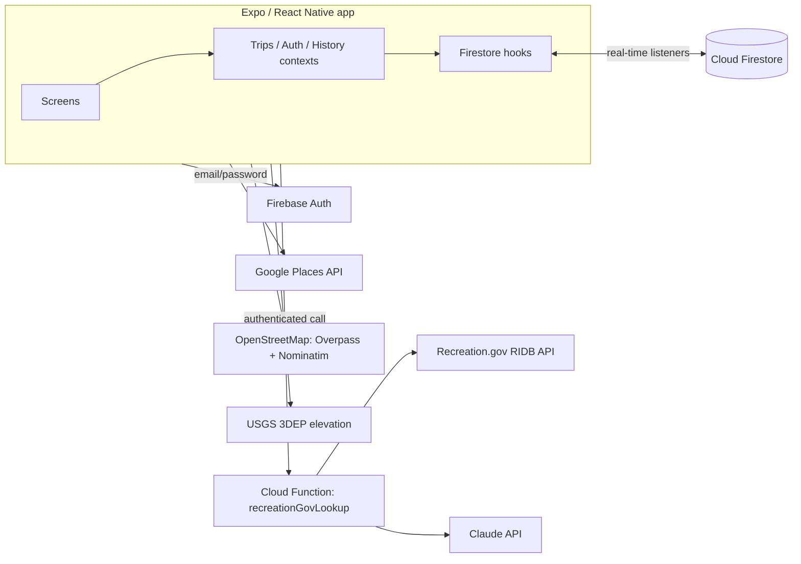

# Architecture

How the pieces fit together, and the tradeoffs behind them.

## Data model

Firestore is the source of truth. A trip is a single document (`trips/{id}`) holding its places, trails, itinerary, meals, and packing list, plus a `messages` subcollection for chat. Each trip carries `ownerUid`, `collaboratorUids`, and a `collaborators` map of display names. The app subscribes to every trip whose `collaboratorUids` contains the signed-in user, so edits from anyone in the group show up live.

All shapes live in [`src/types/index.ts`](src/types/index.ts). The itinerary is the most connected part: events reference places, trails, and packing items by ID, and meals and ingredients carry their own assignees, which powers the per-person "my assignments" view.

**Tradeoff:** one document per trip keeps reads cheap and makes the whole trip arrive in one real-time update. The costs are that lists are written back as whole arrays, so two people editing the same list at the same moment is last-write-wins, and a trip is bounded by Firestore's 1 MB document limit. That's a reasonable trade for small groups; per-item subcollections or transactional updates are the next step if it isn't.

## Collaboration and security

Access is enforced server-side by [`firestore.rules`](firestore.rules), not by the app:

- **Only members can read a trip** or its chat. There is no "any signed-in user" read path.
- **Invite codes live in their own collection** (`inviteCodes/{code}` → `{ tripId, ownerUid }`), so a code reveals a trip ID and nothing else. Codes can be fetched by exact value but never listed, which stops anyone harvesting them. They're 8 characters from a cryptographically secure random source (about 1 trillion possibilities).
- **Joining can only add yourself.** A non-member's write may append their own ID and name, and touch nothing else, and only while the trip's invite code is still live.
- **Codes are bound to their trip.** A code can only be created alongside a trip the caller owns, so nobody can mint or squat codes for someone else's trip.

I verified the rules against the Firebase emulator, covering both the allowed flows and the attacks (tampering while joining, joining with a retired code, reading a trip you're not in).

**Untrusted data:** anything stored on a trip can be edited by any member, so links (recipe URLs, reservation links) open only through [`safeUrl.ts`](src/utils/safeUrl.ts), which refuses anything but `http(s)`.

## External data

- **Places:** Google Places for search, details, and photos, with Static Maps thumbnails ([`placesApi.ts`](src/utils/placesApi.ts)).
- **Trails:** OpenStreetMap through Overpass, with Nominatim geocoding. Trail distance is computed on-device by summing haversine distances along the returned path ([`overpassApi.ts`](src/utils/overpassApi.ts)).
- **Elevation:** USGS's elevation service answers one point per request, so [`elevationApi.ts`](src/utils/elevationApi.ts) samples a fixed number of points along each trail with bounded concurrency. That balances accuracy, latency, and courtesy to a shared public service. Small deltas below the elevation model's noise floor are ignored, and results are discarded if too many samples fail.

## Backend and AI

One Firebase Cloud Function, `recreationGovLookup` ([`functions/src/index.ts`](functions/src/index.ts)), turns a pasted recreation.gov campground link into structured place data:

1. Parse the facility ID from the URL.
2. Fetch the facility from the official RIDB API: name, location, fees, stay limits, accessibility, reservation link.
3. If the description is long, summarize it with Claude Haiku. A small, fast model fits narrow extractive work; short descriptions skip the AI call entirely; and any AI failure falls back to a truncated original, so the lookup never fails because of the summary.

**Why server-side:** the Anthropic and RIDB keys can't be restricted to the app the way a Google key can, so they live only as Cloud Functions secrets and never ship to the client. The function rejects unauthenticated callers explicitly, and upstream error details are logged server-side rather than returned to users.

**AI is used narrowly on purpose.** RIDB already returns trustworthy structured data, so the model never extracts or guesses facts; it only condenses text. The same principle carries forward: anything AI-drafted will be shown for review before it's saved. (The prompt text itself is omitted from this public snapshot.)

## Trip history

The history screen is a personal, cross-trip recap: nights out, nights by type of stay, trail distance and elevation, and a life list of places and trails. All aggregation is pure, unit-tested functions ([`tripHistory.ts`](src/utils/tripHistory.ts), [`tripHistoryStats.ts`](src/utils/tripHistoryStats.ts)).

Past trips are read live while you're still a member. If you leave a past trip, a trimmed snapshot is written to your own `userTripHistory` collection in the same atomic batch, so your history survives. It deliberately drops other members' names and assignments, because it's your record, not a backup of the group's trip.

## Quality and operations

- **Tests:** Jest unit tests for the pure logic (trail math, elevation, trip-history stats, overnight stays, invite codes, URL safety), plus the Cloud Function's parsing and RIDB mapping.
- **CI:** GitHub Actions runs typecheck, lint, and tests for the app and for `functions/` on every push and PR.
- **Secrets:** client keys come from a gitignored `.env` ([`.env.example`](.env.example) documents them), and a pre-commit hook blocks key-shaped strings.
- **Errors:** a small logger is silent in production builds and forwards errors to Sentry.

## What I'd do next

- **Concurrent edits:** move hot lists to per-item writes or transactions to remove last-write-wins.
- **Abuse protection:** add Firebase App Check and per-user rate limits on the Cloud Function.
- **Rules tests in CI:** run the emulator-based rules tests automatically.
- **Offline support** for low-signal trailheads.
