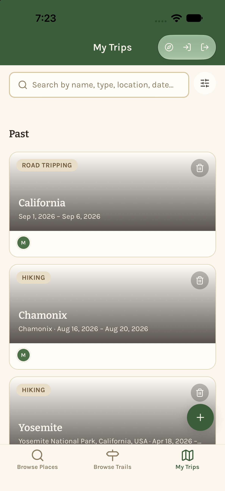
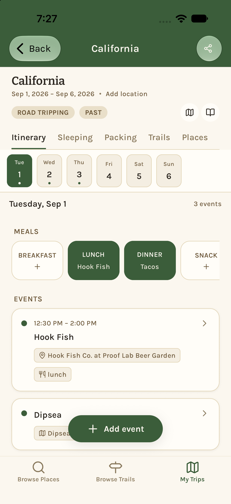
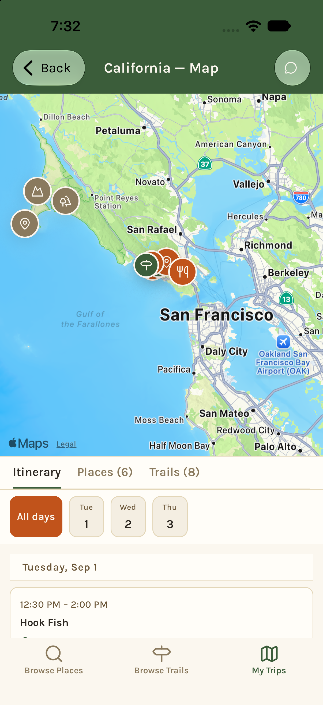
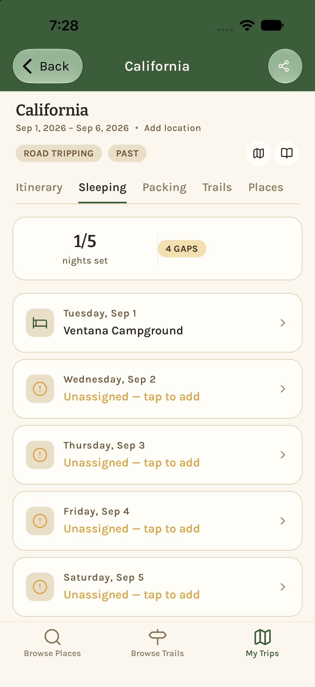
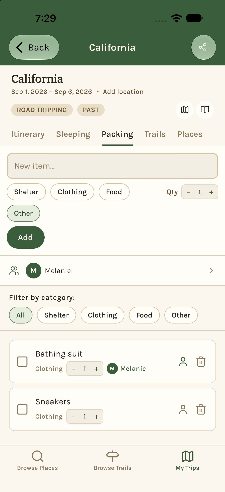
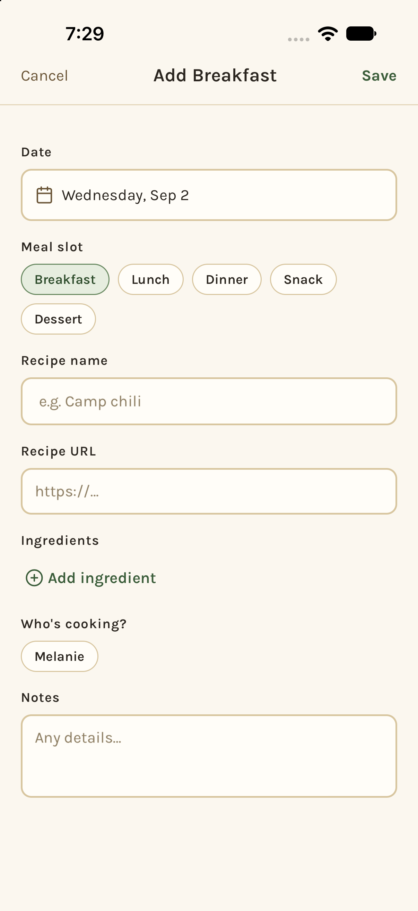
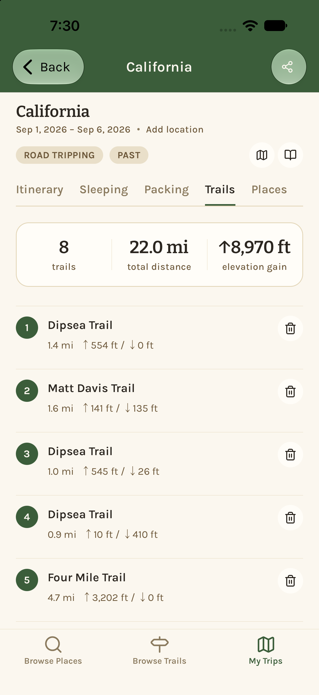
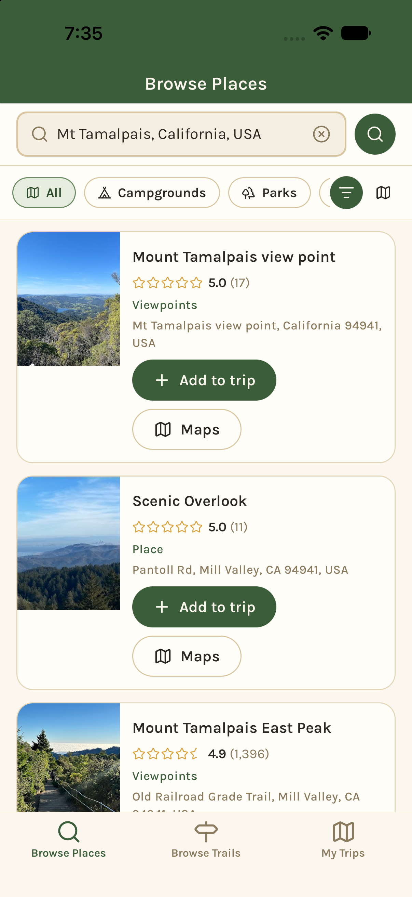
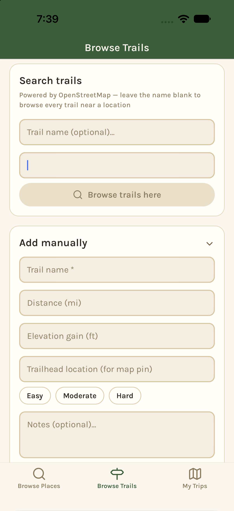

# Switchback

**One place to plan a multi-stop outdoor trip with your friends.**

Planning a backpacking or camping trip usually means juggling a map app, a shared doc, a group chat, a spreadsheet of gear, and a dozen browser tabs. Switchback pulls the planning into a single, collaborative workspace built for group trips involving trails, campsites, and backcountry logistics.

> Status: working prototype, actively in development. This repository is a portfolio snapshot; the app is not deployed for public use.

---

## Screenshots

| Trips | Itinerary | Trip map |
| :---: | :---: | :---: |
|  |  |  |
| **Where we're sleeping** | **Packing list** | **Meal planning** |
|  |  |  |
| **Trip trails** | **Browse places** | **Browse trails** |
|  |  |  |

---

## Why I built this

Planning a multi-spot group trip usually becomes a convoluted mess of Google docs, text chains, emails, and shared calendars. I kept running into this problem planning my own trips, so I built the tool I wanted in collaboration with Claude Code, enabling me to learn how to use the powerful tool as well. The app's focus is on **coordination and organization**, not on replacing the research and booking platforms that already do those things well.

---

## Features

- **Place search and pinning:** search places (Google Places) and save trailheads, campsites, and points of interest to a trip, with an interactive map for each
- **Trail search with elevation:** find trails near any location from OpenStreetMap, with distance and elevation gain/loss computed from USGS elevation data
- **Itinerary builder:** organize events, places, and trails into a day-by-day plan, with a map view of the trip
- **Real-time collaboration:** invite friends with a trip code; everyone sees changes live, plus a built-in group chat
- **Meal plans:** plan meals by day, with ingredients and who's bringing what
- **Packing lists and assignments:** shared checklists, plus a per-person view of everything you're responsible for
- **Where we're sleeping:** each night of the trip, matched to the campground or lodging you've saved
- **Trip history:** a personal recap across past trips: nights out, trail miles and elevation, and a life list of places and trails
- **Public land data:** paste a recreation.gov campground link to pull official facility data (fees, stay limits, accessibility, reservation link) from the federal Recreation Information Database (RIDB)
- **AI-assisted summaries:** long campground descriptions are condensed with the Claude API, server-side, so the key details are easy to scan

---

## Tech stack

| Layer              | Technology                                                                                         |
| ------------------ | -------------------------------------------------------------------------------------------------- |
| Mobile app         | React Native, Expo                                                                                 |
| Language           | TypeScript                                                                                         |
| Backend / database | Firebase: Cloud Firestore (real-time sync), Cloud Functions                                        |
| Auth               | Firebase Auth (email/password)                                                                     |
| Maps / places      | Google Places API, `react-native-maps`, OpenStreetMap (Overpass + Nominatim)                       |
| Elevation          | USGS 3DEP Elevation Point Query Service                                                            |
| Public land data   | [Recreation.gov RIDB API](https://ridb.recreation.gov/docs)                                        |
| AI                 | [Anthropic Claude API](https://docs.claude.com) (Claude Haiku), called from a server-side function |
| Quality            | Jest unit tests, ESLint, GitHub Actions CI, Sentry error reporting                                 |

---

## Architecture notes

AI requests go through a server-side function rather than the app itself, so API keys are never exposed to users. AI is used narrowly: recreation.gov already returns structured data, so the model only summarizes long descriptions, and the app falls back to the original text if the call fails. Nothing AI-generated will be saved to a trip without the user reviewing it first.

Access to trips is enforced by Firestore security rules: only a trip's members can read it, invite codes can't be enumerated, and joining a trip can only add yourself.

For outside platforms, the app does not scrape or duplicate their data. Trails come from OpenStreetMap, and places link back to their original source.

See [ARCHITECTURE.md](ARCHITECTURE.md) for how the pieces fit together and the tradeoffs I made.

---

## About

Built by Melanie Forney, a computer science student at Middlebury College.

Built with [Claude Code](https://claude.com/claude-code) as a development partner; [CLAUDE.md](CLAUDE.md) is the project guidance it works from.

## License

Copyright © 2026 Melanie Forney. All rights reserved.

This repository is public for portfolio purposes. The code may not be copied, modified, or redistributed without permission.
